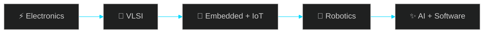

<div align="center">


<br/>


<br/>

<a href="https://github.com/manishkumar250sp-pixel"></a>
<a href="https://www.linkedin.com/in/YOUR-LINKEDIN-ID"></a>
<a href="mailto:YOUR_EMAIL@example.com"></a>

</div>


## 🧑‍🚀 &nbsp;ABOUT ME

<table>
<tr>
<td align="center" width="32%">


**Manish Kumar**<br/>
<sub>ECE Student · Presidency University, Bengaluru</sub>


</td>
<td width="68%">

```text
┌─[ manish@presidency-univ ]─[~/profile]
└─▶ whoami
    Electronics & Communication Engineering student

┌─[ manish@presidency-univ ]─[~/profile]
└─▶ cat domains.txt
    Electronics · VLSI · Robotics · Embedded Systems
    IoT · AI · Software Development

┌─[ manish@presidency-univ ]─[~/profile]
└─▶ echo $MISSION
    Turn engineering ideas into working technology
```

> 💬 *"Build things that outlive the doubt."*

</td>
</tr>
</table>

### 🧭 Focus Path




## 🎴 &nbsp;ANIME SQUAD

<div align="center">
<table>
<tr>
<td align="center" width="50%">

</td>
<td align="center" width="50%">

</td>
</tr>
<tr>
<td align="center" width="50%">

</td>
<td align="center" width="50%">

</td>
</tr>
</table>
</div>

<!--
 WANT REAL ANIME GIFs? Edit this README on github.com, drag a downloaded .gif into the editor,
 and GitHub inserts a permanent https://github.com/user-attachments/... link. Paste it under a card.
-->


## ⚡ &nbsp;TECH STACK

<!-- Delete anything you don't genuinely use. -->

<div align="center">

**💻 PROGRAMMING**<br/>


**🌐 SOFTWARE**<br/>


**🔌 HARDWARE**<br/>
<br/>


**🛠️ TOOLS**<br/>


</div>


## 🚀 &nbsp;PROJECT SHOWCASE

<table>
<tr>
<td width="50%" valign="top">

### 🚑 MediReach
Emergency communication system using **ESP32** and **LoRa mesh networking**.

`ESP32` · `LoRa` · `Mesh Networking`

**Status:** ⚙️ *edit status* &nbsp;|&nbsp; [📂 Repo](https://github.com/manishkumar250sp-pixel?tab=repositories)

</td>
<td width="50%" valign="top">

### 🧲 Zero Contact X
Magnetic levitation platform using magnetic repulsion and **Arduino-based closed-loop control**.

`Arduino` · `Control Systems` · `Electromagnetics`

**Status:** ⚙️ *edit status* &nbsp;|&nbsp; [📂 Repo](https://github.com/manishkumar250sp-pixel?tab=repositories)

</td>
</tr>
<tr>
<td width="50%" valign="top">

### 📚 THE STUDENT
Academic notes portal using **Next.js**, **Firebase Authentication** and **Firestore**.

`Next.js` · `Firebase` · `Firestore`

**Status:** ⚙️ *edit status* &nbsp;|&nbsp; [📂 Repo](https://github.com/manishkumar250sp-pixel?tab=repositories)

</td>
<td width="50%" valign="top">

### 🕶️ SiliconSorcery AR
Gesture-controlled **AR concept** for interactive VLSI learning using **MediaPipe** and **Three.js**.

`MediaPipe` · `Three.js` · `AR` · `VLSI`

**Status:** 💡 Concept &nbsp;|&nbsp; [📂 Repo](https://github.com/manishkumar250sp-pixel?tab=repositories)

</td>
</tr>
</table>


## 📊 &nbsp;GITHUB STATS

<div align="center">


</div>


## 📡 &nbsp;CONTACT

<div align="center">

**Got a hardware, VLSI or robotics idea? Let's build it. ⚡**

<a href="https://github.com/manishkumar250sp-pixel"></a>
<a href="https://www.linkedin.com/in/YOUR-LINKEDIN-ID"></a>
<a href="mailto:YOUR_EMAIL@example.com"></a>

<br/><br/>


</div>
